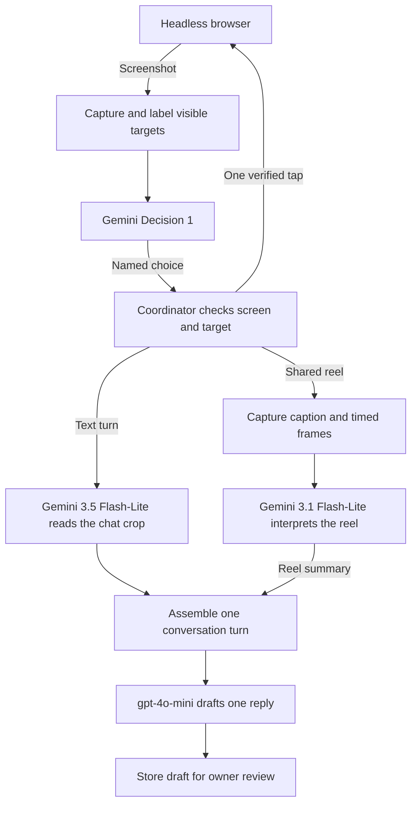

# Shadow architecture

## Execution boundary

One Python process coordinates one authenticated browser session, one active tab and local SQLite state. The new browser boundary accepts screenshot, tap, scroll and text-input operations. Page interpretation uses visible pixels. The existing Playwright and DOM modules remain evidence of how the prototype behaves. The screenshot path must work without selectors, page JavaScript or Instagram private endpoints.

Earlier live reads reached a requested window of 60 messages while still reporting incomplete history. Screenshots let Shadow see the reel, caption and surrounding chat as the owner sees them. They provide no proof of complete history, platform message IDs or an unsend.

## One turn through the system

Decision 1 can choose to open a reel. Once the player is visible, a local timer collects frames. The smaller multimodal model interprets the batch, and the coordinator adds its summary to the chat context for the main reply model.

## Translating a decision into a tap

Keep a small vocabulary of roughly 10–15 actions across the app. Offer only choices relevant to the current screen. A fixed viewport and zoom permit pre-calibrated regions for stable controls such as Back or Close. Inbox rows and reel cards move. Find plausible regions in the **current** image, overlay numbers on a copy and keep the original for transcription. The browser trial shows runtime code finding those boxes from visible contrast. The draft loop does not use the fixture's colored markers.

For example, an annotated screenshot might contain a chat header, two reel cards and a composer. The request describes which numbered region corresponds to each visible candidate and asks which card the latest incoming turn refers to. Decision 1 selects a supplied option or `hold`. The coordinator owns the mapping from option to pixel and verifies the resulting screen before continuing. The system instructions describe what makes an action appropriate. Hard-coding every pixel into a prompt would leave code unable to detect a moved target.

## Component ownership

| Component | Responsibility and reuse |
| --- | --- |
| Browser adapter | Use headless Chromium with a persistent browser profile. Capture the fixed viewport and dispatch coordinate input through the Chrome DevTools Protocol. Verify session persistence, typing and reel playback on each deployment host. [Chrome DevTools Protocol](https://chromedevtools.github.io/devtools-protocol/) |
| Screen decision | Use the latest screenshot or a crop as the evidence in every `gemini-decision-1` request. Include the task and bounded choices as instructions. Use the winning choice and its confidence for routing. [Google Decisions API](https://blog.google/innovation-and-ai/technology/developers-tools/gemini-decisions-api/) |
| Chat inputs | `gemini-3.5-flash-lite` transcribes the original conversation crop into ordered bubbles. Decision 1 does not receive that transcript. The reply model receives the bubbles and any reel summary, not a second copy of unrelated threads. |
| Reel understanding | `gemini-3.1-flash-lite` interprets timestamped frames. Speech is omitted unless audio was actually captured. The reply model receives that summary with the sender’s message. |
| Coordinator and storage | Reuse the account scope, pause, revision and SQLite transaction concepts in `shadow/coordinator.py` and `shadow/storage.py`. Check their current identity assumptions before admitting screenshot observations. |
| Reply and owner review | Reuse scoped memory, quality checks, approvals and the outbox where their contracts hold. Browser actions belong to the coordinator. Models receive conversation content as data and have no authority to send. |

## Concurrency and recovery

Serialize browser interactions. Release the browser while a draft is being generated, then recheck the recipient and conversation revision before using the result. A new turn can invalidate a pending draft. A popup can invalidate a previously valid coordinate. A restart discards in-memory screenshots and tap candidates. Persist the conversation and draft state needed for recovery. The [TRD](trd.md) defines what evidence permits progress at each boundary.
