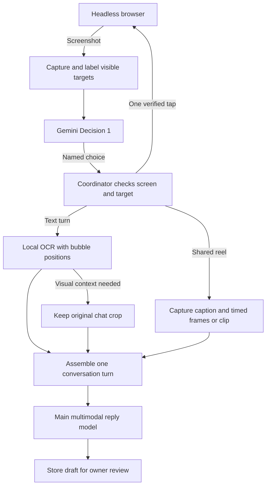

# Shadow architecture

## Execution boundary

One Python process coordinates one authenticated browser session, one active tab and local SQLite state. The new browser boundary accepts screenshot, tap, scroll and text-input operations. Page interpretation uses visible pixels. The existing Playwright and DOM modules remain evidence of how the prototype behaves. The screenshot path must work without selectors, page JavaScript or Instagram private endpoints.

Earlier live reads reached a requested window of 60 messages while still reporting incomplete history. Screenshots let Shadow see the reel, caption and surrounding chat as the owner sees them. They provide no proof of complete history, platform message IDs or an unsend.

## One turn through the system

The coordinator controls when to capture and where an image goes. Decision 1 can choose to open a reel. Once the player is visible, a local timer collects frames and the coordinator submits the batch to the reply model. There is no reason to ask Decision 1 whether to take each successive frame.

## Translating a decision into a tap

Keep a small vocabulary of roughly 10–15 actions across the app. Offer only choices relevant to the current screen. A fixed viewport and zoom permit pre-calibrated regions for stable controls such as Back or Close. Inbox rows and reel cards move. Find plausible regions in the **current** image, overlay numbers on a copy and retain the original for OCR. The first API experiment can use hand-labeled boxes. The browser trial must demonstrate how runtime code finds those boxes, using visible layout, OCR boxes or image matching.

For example, an annotated screenshot might contain a chat header, two reel cards and a composer. The request describes which numbered region corresponds to each visible candidate and asks which card the latest incoming turn refers to. Decision 1 selects a supplied option or `hold`. The coordinator owns the mapping from option to pixel and verifies the resulting screen before continuing. The system instructions describe what makes an action appropriate. Hard-coding every pixel into a prompt would leave code unable to detect a moved target.

## Component ownership

| Component | Responsibility and reuse |
| --- | --- |
| Browser adapter | Obscura is the first candidate after the API trial. Exercise its render-enabled screenshot and mouse-input support directly. Verify actual login persistence, view geometry, typing and reel playback on the target machine. [Obscura protocol support](https://github.com/h4ckf0r0day/obscura#cdp-api) |
| Screen decision | Give `gemini-decision-1` one image, a task and bounded questions. Use the winning choice and its confidence for routing. The API supports independent choice, yes/no and scoring questions on shared multimodal input. [Google Decisions API](https://blog.google/innovation-and-ai/technology/developers-tools/gemini-decisions-api/) |
| Text and media inputs | Local OCR supplies text and geometry. If a quote, emoji or layout needs visual interpretation, the main reply model receives the original chat crop in the same request as the available text. Reel evidence goes to the same model with the sender’s text, caption and any available audio. |
| Coordinator and storage | Reuse the account scope, pause, revision and SQLite transaction concepts in `shadow/coordinator.py` and `shadow/storage.py`. Check their current identity assumptions before admitting screenshot observations. |
| Reply and owner review | Reuse scoped memory, quality checks, approvals and the outbox where their contracts hold. Browser actions belong to the coordinator. Models receive conversation content as data and have no authority to send. |

## Concurrency and recovery

Serialize browser interactions. Release the browser while a draft is being generated, then recheck the recipient and conversation revision before using the result. A new turn can invalidate a pending draft. A popup can invalidate a previously valid coordinate. A restart discards in-memory screenshots and tap candidates. Persist the conversation and draft state needed for recovery. The [TRD](trd.md) defines what evidence permits progress at each boundary.
