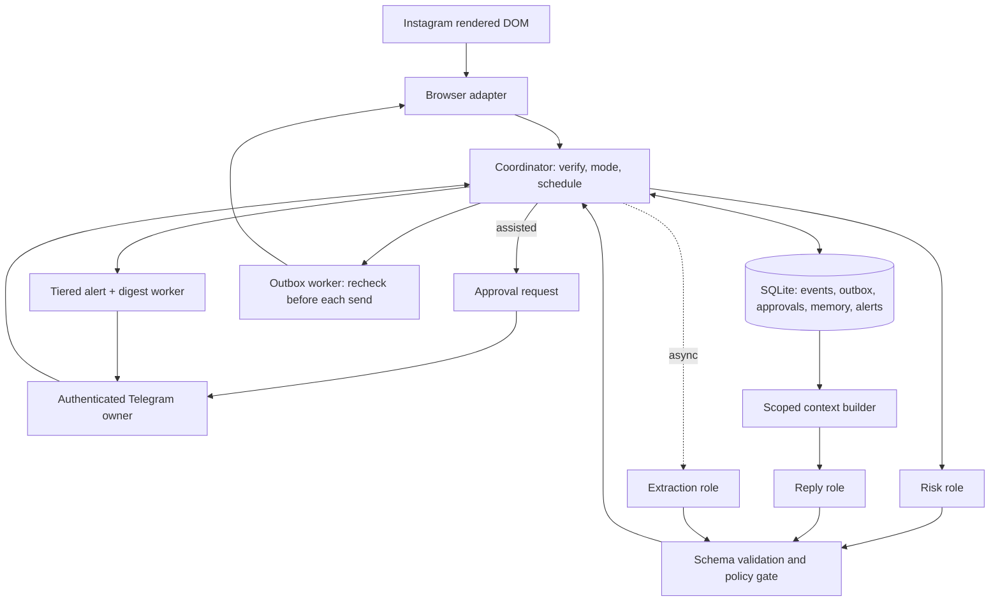

# Architecture

Target design; not a description of completed runtime. See [feature.md](feature.md) for current gaps.

## Single installation

One Python process owns one SQLite database and one dedicated Instagram browser tab. A browser lock serializes every operation that depends on which thread is open. Telegram reception and provider calls may run concurrently, but they never manipulate that tab directly. A process lock prevents a second writer for the same account/data directory.

No untrusted Instagram content or model output can call Telegram commands, SQL, shell, navigation, or send methods. The coordinator interprets small validated structures; ordinary message text is data. The three model roles are separate calls through one provider boundary; see [trd.md](trd.md#model-integration).

## Modes

`observe` → `assisted` → `autonomous` ([trd.md](trd.md#operating-modes)). The pipeline is identical in all three; mode only decides whether a validated draft is discarded (observe), sent to Telegram for approval (assisted), or queued for its due time (autonomous, in-scope contacts only). This keeps one tested path and lets the owner get value before autonomy is qualified.

## Reuse and changes

| Existing code | Keep | Change |
| --- | --- | --- |
| `shadow/main.py`, Click CLI | Entry points and local diagnostics | Add onboarding, memory/status/control commands; avoid raw private logs |
| `shadow/config.py` | Environment loading and explicit settings | External private data directory, typed validation, timezone, limits, no hard-coded identity or selected model |
| `shadow/browser.py` | Persistent CDP connection, exact-host intent, pane extraction, trusted scrolling | Dedicated tab/account binding, exact thread checks, ambiguity states, observation identity, per-item send evidence |
| `shadow/loop.py` | Single coordinator and simple async runtime | Replace preview-name replay guard with durable work and revision checks; remove story work; no blocking model call on event loop |
| `shadow/memory.py` | Legacy import knowledge and usable-text filtering | SQLite repository, stable identity, provenance, retention, correction records; retire fuzzy matching for runtime authority |
| `shadow/brain.py` | Prompt separation idea and provider integration knowledge | Split into risk/reply/extraction roles with strict contracts, neutral profile, capability-aware adapters, fail closed on malformed output |
| `build_voice.py` | Statistics and extraction as diagnostics | Owner-authored/approved examples only, deduplication, train/dev/test separation before fitting, no mandatory averages |
| `make_eval_set.py`, `eval_voice.py` | Frozen cases and comparative reports | Full prior context, causal cutoff, multilingual/humour/risk rubrics, no private data required in CI |
| `drive.py`, `probe.py` | Read-only parser diagnostics | Same production parser and identity path; protect raw captures; no hidden sends |
| `test_shadow.py` | Relevant regression intent | Synthetic fixtures; behavioural checks replace source-text assertions |
| Root baseline documents | Historical explanation | New `plan/` authority; audit old text before publication |

New modules are justified only where responsibility is independent: proposed `storage.py` for schema/migrations if memory.py becomes unclear, `telegram.py`, `providers.py`, and `policy.py`. Do not create a plugin framework, abstract repository tree, worker hierarchy, or generic platform adapter for a single implementation.

## Read-to-send flow

1. Read the rendered thread list in-page (`inbox_check_interval`) and re-read the open pane (`pane_check_interval`); navigate only when needed and within `navigation_budget`. Do not depend on unread status: opening a DM clears it on the owner's devices before processing completes. Rows whose preview proves no reply is needed are recorded without opening.
2. Resolve candidate row by explicit UI evidence, open it, and bind exact numeric thread ID plus participant evidence. Duplicate names or missing participant evidence require a hold. Unknown contacts become `unknown_pending` with one approval alert.
3. Read typed events from the actual message pane. Persist new observations transactionally. Stable DOM identifiers are used only if P00b found them. An owner-authored event not from the outbox starts takeover for that thread.
4. Coalesce incoming events into one pending revision. Deterministic cues run immediately; the risk role runs after `quick_coalesce` (none for urgent cues). Urgent results alert at once, independent of pacing, mode or active hours.
5. On `proceed`, build scoped context and call the reply role. Validate schema, source references, capability limits and policy. Save the draft and due time (adaptive delay, active hours) in a transaction; the LLM does not write state. Queue extraction asynchronously. A new inbound batch invalidates the draft and triggers fresh assessment.
6. By mode: observe discards the draft after recording it; assisted sends an approval request; autonomous (in-scope contacts) keeps it queued. Skips and holds never create sendable outbox items.
7. At due time (or approval, whichever is later), reopen and reread exact thread, compare revision, takeover and manual-activity markers, check pause/auth/DOM health/active hours/caps and current model/profile versions. Changed context cancels the stale draft and schedules new work; unchanged context does not need a second generation call.
8. Persist the next item as attempting, perform one browser send attempt, and record observed confirmation or uncertainty. Repeat only for items known not attempted and still valid.
9. Append confirmed events and the corresponding cursor/outbox transition atomically. A crash between browser and database requires reconciliation, not a repeated Enter press. The next read checks for confusion signals.

## DOM performance strategy

Retain Playwright as the browser control layer. The current code already uses page-side extraction and direct CDP wheel events; transport replacement alone will not remove Instagram rendering, network, or scrolling delays.

Use a persistent tab, reuse the open thread, collect fields in one in-page read, and fetch deeper history only when local context is insufficient. A MutationObserver may signal changes in the currently rendered pane; it does not observe every off-screen thread. Keep periodic inbox reconciliation and reinstall observers after navigation.

Measure navigation, readiness, extraction, history expansion, model time, deliberate delay, typing, and confirmation separately. Warm in-page extraction target: p95 below 500 ms on the measured host; end-to-end reads can take seconds. Do not trade identity evidence for latency, use Instagram private endpoints, or promise millisecond message arrival.

## Presence and account risk

Instagram's terms do not permit automated access; the owner accepts that account restriction is possible. The design limits exposure rather than claiming to prevent it: one persistent tab, in-page reads instead of reload loops, a hard navigation budget, no story/like/profile activity, one consistent host and browser profile, and a global pause on any challenge screen. Owner read receipts are off; activity status is an owner choice recorded at setup. Details and numbers are in [trd.md](trd.md#presence-and-account-footprint).

## Storage and trust

SQLite is the source of truth; JSON exports and voice snapshots are versioned derived artifacts. Keep the database, profile, logs, browser session, archives, backups, private tests, and generated examples outside the repository by default. TLS protects provider/Telegram transit; those services necessarily receive selected content. This is not an end-to-end encrypted bot chat or a claim of local-only processing.

Telegram has full owner authority only after numeric user AND private chat ID checks. Display names and incoming Instagram claims cannot establish authority. CDP is loopback-only or behind an explicitly secured private tunnel; never expose its port publicly. The host holds the Instagram session, bot token and model keys together, so it is treated as a privileged asset ([operations.md](operations.md#host-hardening)).

## Failure model

Browser/auth/DOM failures pause sending; provider outages postpone bounded work; database corruption stops the process before external writes. Telegram failure retains alerts locally and applies the escalation policy in [operations.md](operations.md). The architecture favours conservative holds over pretending an uncertain send or unreadable conversation succeeded.
